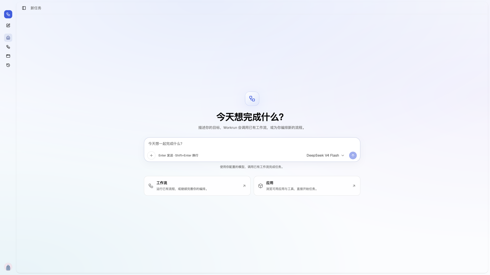
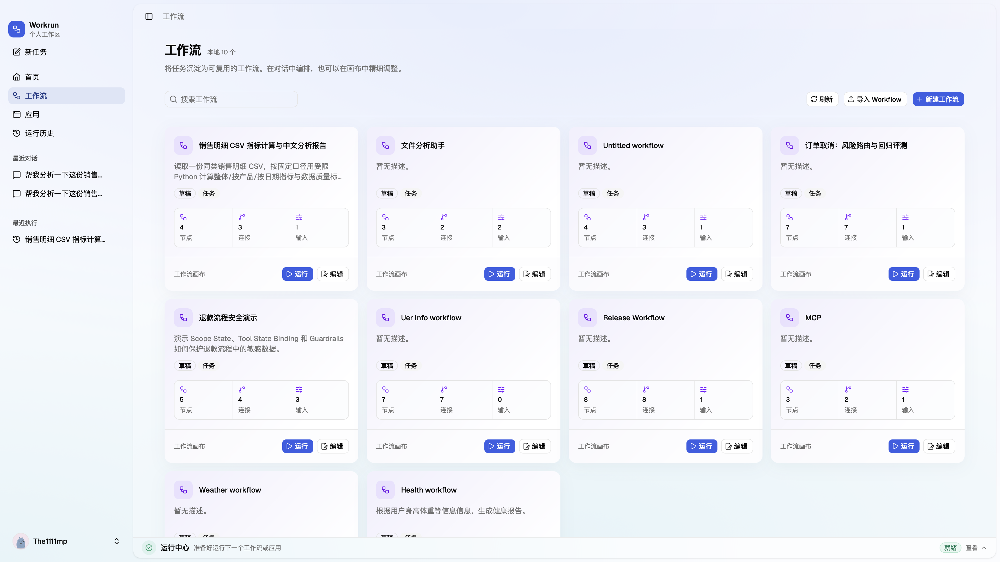
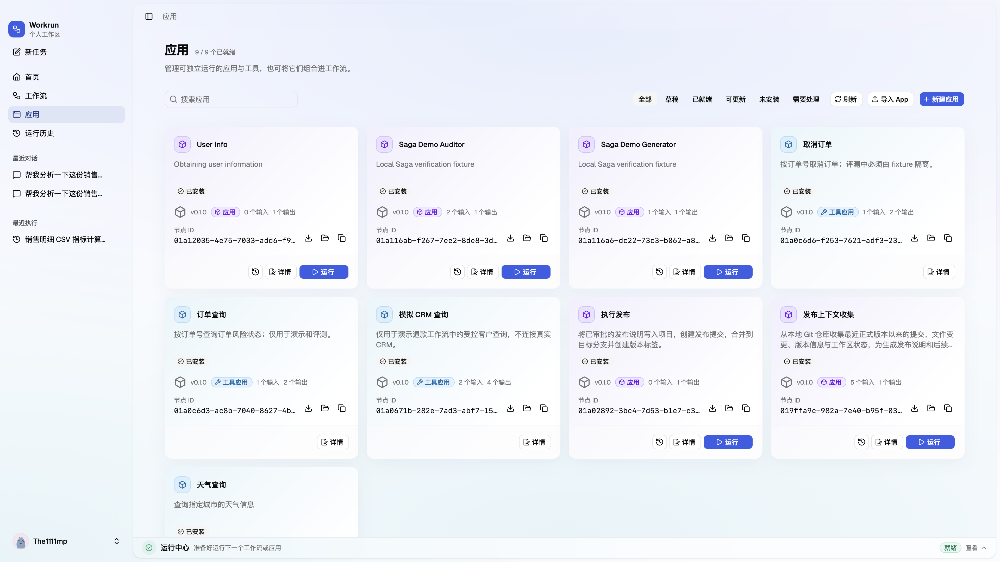
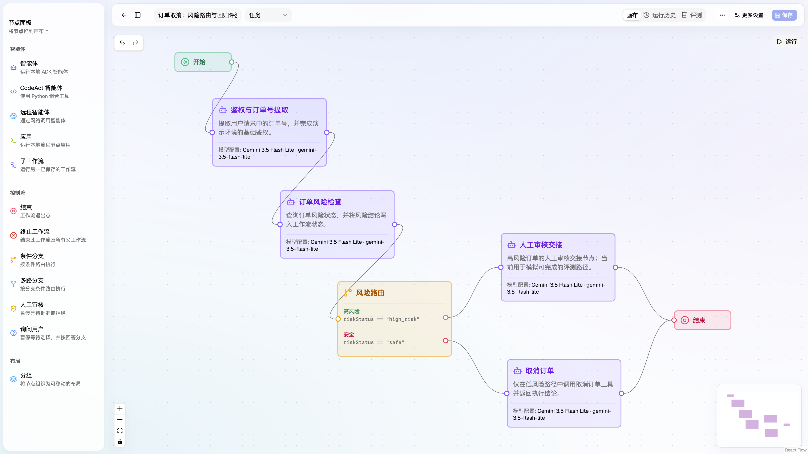
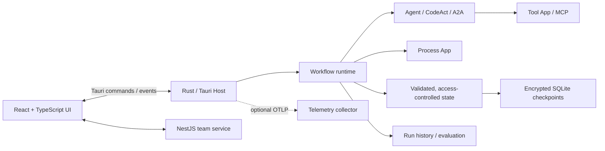

# Workrun

[English](README.md) | **简体中文**

> 本地优先的 AI 自动化工作台。从一次对话开始，将任务沉淀为可编辑、可重复运行的工作流。

用自然语言分析任务、生成工作流，再在画布上调整 Agent、Python App、MCP 工具与人工审核。你也可以直接运行独立的 Python App，按需接入工作流，并通过运行记录、评估和版本发布持续改进。

**个人模式无需登录，工作流和 Python App 在桌面端执行。** 团队可连接自托管 Workrun Server，共享资产和发布版本。

**[下载安装](https://github.com/1111mp/workrun-app/releases/latest) · [中文文档](https://workrun-docs.pages.dev/zh-cn/) · [5 分钟快速开始](https://workrun-docs.pages.dev/zh-cn/getting-started/quickstart/) · [对话搭建工作流](https://workrun-docs.pages.dev/zh-cn/guides/conversational-workflows/)**

<p align="center">
  <picture>
    <source media="(prefers-color-scheme: dark)" srcset="apps/docs/public/media/homepage/start-dark.png" />
    <source media="(prefers-color-scheme: light)" srcset="apps/docs/public/media/homepage/start-light.png" />
    
  </picture>
  <picture>
    <source media="(prefers-color-scheme: dark)" srcset="apps/docs/public/media/homepage/workflows-dark.png" />
    <source media="(prefers-color-scheme: light)" srcset="apps/docs/public/media/homepage/workflows-light.png" />
    
  </picture>
</p>

<p align="center">
  <picture>
    <source media="(prefers-color-scheme: dark)" srcset="apps/docs/public/media/homepage/apps-dark.png" />
    <source media="(prefers-color-scheme: light)" srcset="apps/docs/public/media/homepage/apps-light.png" />
    
  </picture>
  <picture>
    <source media="(prefers-color-scheme: dark)" srcset="apps/docs/public/media/homepage/workflow-editor-dark.png" />
    <source media="(prefers-color-scheme: light)" srcset="apps/docs/public/media/homepage/workflow-editor-light.png" />
    
  </picture>
</p>

## 为什么用 Workrun

| 需求                   | Workrun 的做法                                                         |
| ---------------------- | ---------------------------------------------------------------------- |
| 把临时任务变成自动化   | 在首页对话中分析任务、审阅方案并生成工作流，也可直接在画布上搭建       |
| 将模型与代码组合       | 用 Agent 处理推理，用 Python App 完成确定性计算，通过 MCP 连接外部工具 |
| 在关键步骤保留人工判断 | 审核、提问和工具审批；人工节点完成后从检查点继续                       |
| 检查结果并持续改进     | 查看节点输出、工具调用、脚本日志和 Trace，用评估集对比版本结果         |
| 重复执行与团队复用     | 为 App 和工作流配置定时任务，发布固定依赖版本的团队资产                |

## 从对话到工作流

```text
“帮我分析这份销售数据”
          ↓
“以后还要重复做，帮我做成工作流，先不要运行”
          ↓
审阅方案 → 确认方案并保存 → 在画布中检查或调整
          ↓
“现在帮我运行” → 确认本次工作流与输入 → 查看结果
```

方案确认用于保存工作流，执行确认用于启动本次运行。完整示例见[销售数据分析与工作流编排教程](https://workrun-docs.pages.dev/zh-cn/guides/conversational-workflows/)。

## 快速开始

### 下载安装

前往 [GitHub Releases](https://github.com/1111mp/workrun-app/releases/latest)，选择与你的操作系统和芯片架构匹配的安装包。实际可用平台与安装说明以 Release 页面为准。普通用户无需安装 Node.js、pnpm 或 Rust。

首次启动时选择个人或团队工作区。个人模式填写个人资料即可使用；团队模式需要填写 Workrun Server 地址并登录。

- **从 App 开始**：在 Apps 页面创建本地 Python 项目，编辑代码并直接运行；参见[Python App 指南](https://workrun-docs.pages.dev/zh-cn/guides/python-apps/)。
- **从工作流开始**：在 **设置 → 模型** 配置 Provider API Key（Ollama 配置端点），新建并连接 `Start → Agent → End`，为 Agent 选择对应模型，在 **更多设置 → 运行输入** 定义输入后运行；参见[快速开始](https://workrun-docs.pages.dev/zh-cn/getting-started/quickstart/)。

## 本地开发

### 前置条件

- Node.js 24+
- pnpm 12（仓库锁定 `pnpm@12.11.2`）
- Rust 工具链与对应平台的 Tauri 构建依赖
- Python App 开发需要网络，以便 `uv` 下载 Python 与依赖；发行包会携带 `uv` sidecar

### 启动桌面端开发环境

```bash
git clone https://github.com/1111mp/workrun-app.git
cd workrun-app
pnpm install
pnpm app:dev
```

模型目录由 Workrun 内置，无需新建模型 Profile 或手动填写模型 ID；Provider 密钥加密保存在本机。完整环境说明见[安装与前置条件](https://workrun-docs.pages.dev/zh-cn/getting-started/installation/)。

### 常用命令

```bash
# 桌面端开发 / 仅启动前端
pnpm app:dev
pnpm ui:dev

# 检查
pnpm typecheck
pnpm oxlint
pnpm format
pnpm test

# 官方文档本地开发 / 构建
pnpm docs:dev
pnpm docs:build

# 团队服务（需 MongoDB 和认证环境变量）
pnpm server:dev
```

团队服务环境变量见 [apps/server/.env.example](apps/server/.env.example) 和 [env.validation.ts](apps/server/src/env.validation.ts)，包括 `MONGODB_URI`、`BETTER_AUTH_SECRET`、`SERVER_BASE_URL` 与 `BETTER_AUTH_URL`。部署说明见[团队发布与部署准备](https://workrun-docs.pages.dev/zh-cn/team/publishing/)。Python SDK 的开发与使用说明见 [packages/python-sdk/README.md](packages/python-sdk/README.md)。

## 核心能力

- **可视化工作流**：支持任务与对话模式，组合 Agent、CodeAct Agent、Remote Agent、Process、条件分支、人工节点和子工作流；运行前验证图结构与输入输出 Schema。
- **Agent 与模型**：支持 Gemini、OpenAI 与兼容接口、Anthropic、DeepSeek、Groq 和 Ollama；可配置结构化输出、工具调用限制与超时，并加载兼容 `SKILL.md` 的本地 Skills。
- **Python App**：每个 App 都是完整的本地 `uv` 项目，可独立运行、作为 Process 节点执行，或作为 Tool App 供 Agent 调用。SDK 提供结果返回、表单、输入收集和确认交互。
- **MCP 与远程 Agent**：连接本地 `stdio` 或远程 Streamable HTTP MCP Server，支持 Bearer Token、OAuth 和工具审批；通过 A2A 协议接入 Remote Agent。
- **运行与恢复**：查看节点状态、模型消息、工具调用、脚本日志和 OpenTelemetry Trace；人工节点暂停后可恢复，应用中断的运行可在通过检查点与操作日志检查后恢复。
- **评估与发布**：批量执行评估用例，对比版本结果，通过质量门约束发布；团队工作流固定 Team App 的不可变发布版本。
- **定时与外部调用**：为 App 和工作流配置带时区的 Cron，或通过 `workrun://` 链接打开与请求运行；运行链接仍需用户确认。
- **状态与凭据保护**：逐节点授权私有输出读取，支持敏感字段、加密检查点、PII 脱敏与工具参数护栏；Provider 和 MCP 凭据加密保存在本机。

### 使用边界

- 本地 Python App **不是沙箱**，请仅运行可信代码。CodeAct Agent 使用单独的受限 Python 运行环境。
- 定时任务仅在桌面应用打开时执行，不补跑关闭期间错过的触发；同一目标忙碌时跳过触发。包含人工审核或提问节点的工作流不能保存为定时任务。
- 评估暂不支持包含 Process、CodeAct Agent 或 Remote Agent 的工作流，包括通过子工作流引用；人工节点需要手动处理。
- 失败或已停止的运行需通过**重新运行**创建新任务。只有应用退出或崩溃造成的中断运行，才能在通过检查点和操作日志检查后恢复原任务。
- 团队服务管理身份、共享资产和发布版本，实际执行仍在成员桌面端。个人与团队工作区相互独立。

## 进阶指南

| 主题               | 文档                                                                                                                                                              |
| ------------------ | ----------------------------------------------------------------------------------------------------------------------------------------------------------------- |
| 画布、节点与状态   | [搭建工作流](https://workrun-docs.pages.dev/zh-cn/guides/build-a-workflow/) · [工作流与状态](https://workrun-docs.pages.dev/zh-cn/concepts/workflows-and-state/)  |
| Python 项目与交互  | [Python App](https://workrun-docs.pages.dev/zh-cn/guides/python-apps/) · [Python SDK](packages/python-sdk/README.md)                                              |
| 外部工具与人工参与 | [连接 MCP](https://workrun-docs.pages.dev/zh-cn/guides/connect-an-mcp-server/) · [人工审核与恢复](https://workrun-docs.pages.dev/zh-cn/guides/human-in-the-loop/) |
| 运行质量           | [运行与追踪](https://workrun-docs.pages.dev/zh-cn/quality/runs-and-traces/) · [评估与质量门](https://workrun-docs.pages.dev/zh-cn/quality/evaluations/)           |
| 自动触发           | [定时运行](https://workrun-docs.pages.dev/zh-cn/guides/scheduled-runs/) · [Deeplink](https://workrun-docs.pages.dev/zh-cn/guides/deeplinks/)                      |
| 团队共享           | [发布与部署](https://workrun-docs.pages.dev/zh-cn/team/publishing/)                                                                                               |

## 架构概览



| 区域       | 位置                                       | 作用                                                      |
| ---------- | ------------------------------------------ | --------------------------------------------------------- |
| 桌面应用   | `apps/desktop`                             | React UI、React Flow 画布、运行面板、设置与团队体验       |
| 本地运行时 | `apps/desktop/src-tauri`                   | Rust 工作流编译/执行、状态与检查点、Python/MCP 管理、遥测 |
| 团队服务   | `apps/server`                              | NestJS、认证、团队 App / Workflow / 文件 API 与发布版本   |
| 官方文档   | `apps/docs`                                | Astro / Starlight 中英文文档、教程与演示媒体              |
| Python SDK | `packages/python-sdk`                      | App 结果协议和本地 IPC 表单/确认 API                      |
| 共享包     | `packages/ui`、`packages/json-schema-form` | UI 基础组件与 JSON Schema 表单                            |

## 演示

### Python App：创建与运行

<a href="https://github.com/1111mp/workrun-app/releases/download/resources/app.mp4">
  
</a>

### Workflow：配置并运行 Health Agent

<a href="https://github.com/1111mp/workrun-app/releases/download/resources/workflow.mp4">
  
</a>

## 项目状态与路线图

已具备独立 App、本地工作流、App/MCP 集成、定时运行、运行恢复、评估、遥测，以及团队发布和运行已发布工作流的基础能力。以下方向仍在持续完善，不应视为既有承诺：

- 更完整的资产同步、导入导出、模板和市场发现体验。
- 更丰富的节点、连接器、运行控制与可复现调试信息。
- 更成熟的权限、插件机制和跨平台运行时体验。
- 团队协作下更细粒度的版本、权限和发布流程。

## 参与贡献

欢迎围绕工作流节点与运行时、模型和工具集成、桌面端体验、Python SDK、评估体系、示例流程和文档贡献改进。较大的设计变更建议先通过 Issue 讨论。

## License

本项目采用 [LICENSE](LICENSE) 中的许可证。
