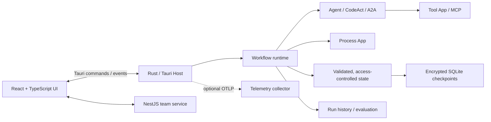

# Workrun

**English** | [简体中文](README-zh_CN.md)

> A local-first AI automation workbench. Start with a conversation and turn a task into an editable, reusable workflow.

Describe a task, generate a workflow, then refine agents, Python apps, MCP tools, and human review on a visual canvas. You can also run Python apps independently, connect them to workflows, and improve them through run history, evaluations, and versioned releases.

**Personal mode needs no login; workflows and Python apps execute on your desktop.** Teams can connect a self-hosted Workrun Server to share assets and published versions.

**[Download](https://github.com/1111mp/workrun-app/releases/latest) · [Documentation](https://workrun-docs.pages.dev/) · [5-minute quickstart](https://workrun-docs.pages.dev/getting-started/quickstart/) · [Build through conversation](https://workrun-docs.pages.dev/guides/conversational-workflows/)**

<p align="center">
  <picture>
    <source media="(prefers-color-scheme: dark)" srcset="apps/docs/public/media/homepage/start-dark.png" />
    <source media="(prefers-color-scheme: light)" srcset="apps/docs/public/media/homepage/start-light.png" />
    
  </picture>
  <picture>
    <source media="(prefers-color-scheme: dark)" srcset="apps/docs/public/media/homepage/workflows-dark.png" />
    <source media="(prefers-color-scheme: light)" srcset="apps/docs/public/media/homepage/workflows-light.png" />
    
  </picture>
</p>

<p align="center">
  <picture>
    <source media="(prefers-color-scheme: dark)" srcset="apps/docs/public/media/homepage/apps-dark.png" />
    <source media="(prefers-color-scheme: light)" srcset="apps/docs/public/media/homepage/apps-light.png" />
    
  </picture>
  <picture>
    <source media="(prefers-color-scheme: dark)" srcset="apps/docs/public/media/homepage/workflow-editor-dark.png" />
    <source media="(prefers-color-scheme: light)" srcset="apps/docs/public/media/homepage/workflow-editor-light.png" />
    
  </picture>
</p>

## Why Workrun

| Need                                | How Workrun helps                                                                                      |
| ----------------------------------- | ------------------------------------------------------------------------------------------------------ |
| Turn a one-off task into automation | Analyze a task in conversation, review a plan, and generate a workflow—or build directly on the canvas |
| Combine models with code            | Use agents for reasoning, Python apps for deterministic processing, and MCP for external tools         |
| Keep people involved                | Add review, questions, and tool approval; resume from checkpoints after human nodes complete           |
| Inspect and improve results         | Review node output, tool calls, logs, and traces; compare versions with evaluation cases               |
| Repeat and share your work          | Schedule apps and workflows, and publish team assets with pinned dependency versions                   |

## From conversation to workflow

```text
“Help me analyze this sales data.”
          ↓
“Turn this into a reusable workflow, but don't run it yet.”
          ↓
Review plan → Approve and save → Inspect or edit on the canvas
          ↓
“Run it now.” → Confirm the workflow and inputs → Inspect results
```

Plan approval saves the workflow; a separate execution confirmation starts the run. Follow the [sales-analysis walkthrough](https://workrun-docs.pages.dev/guides/conversational-workflows/) for a complete example.

## Quick start

### Download and install

Visit [GitHub Releases](https://github.com/1111mp/workrun-app/releases/latest) and select the installer for your operating system and CPU architecture. Available platforms and installation instructions are listed on the release page. End users do not need Node.js, pnpm, or Rust.

On first launch, choose a personal or team workspace. In personal mode, complete your profile to get started. Team mode requires a Workrun Server URL and login.

- **Start with an app:** create a local Python project in Apps, edit its code, and run it directly. See the [Python app guide](https://workrun-docs.pages.dev/guides/python-apps/).
- **Start with a workflow:** configure a provider API key in **Settings → Models** (an endpoint for Ollama), connect `Start → Agent → End`, choose the corresponding model for the agent, and define inputs in **More settings → Run inputs** before running. See the [quickstart](https://workrun-docs.pages.dev/getting-started/quickstart/).

## Local development

### Prerequisites

- Node.js 24+
- pnpm 12 (pinned to `pnpm@12.11.2` in this repository)
- Rust toolchain and the Tauri build dependencies for your platform
- Network access for Python app development so `uv` can download Python and dependencies; release packages include a `uv` sidecar

### Start desktop development

```bash
git clone https://github.com/1111mp/workrun-app.git
cd workrun-app
pnpm install
pnpm app:dev
```

Workrun includes a built-in model catalog; there is no need to create model profiles or enter model IDs manually. Provider credentials are encrypted locally. See [installation and prerequisites](https://workrun-docs.pages.dev/getting-started/installation/) for full setup instructions.

### Common commands

```bash
# Desktop development / frontend only
pnpm app:dev
pnpm ui:dev

# Checks
pnpm typecheck
pnpm oxlint
pnpm format
pnpm test

# Documentation development / build
pnpm docs:dev
pnpm docs:build

# Team service (requires MongoDB and authentication environment variables)
pnpm server:dev
```

Team service environment variables are defined in [apps/server/.env.example](apps/server/.env.example) and [env.validation.ts](apps/server/src/env.validation.ts), including `MONGODB_URI`, `BETTER_AUTH_SECRET`, `SERVER_BASE_URL`, and `BETTER_AUTH_URL`. See [team publishing and deployment preparation](https://workrun-docs.pages.dev/team/publishing/) for deployment guidance. Python SDK development and usage instructions are in [packages/python-sdk/README.md](packages/python-sdk/README.md).

## Core capabilities

- **Visual workflows:** task and conversation modes with agents, CodeAct agents, remote agents, Python processes, branches, human nodes, and subworkflows. Graphs and input/output schemas are validated before execution.
- **Agents and models:** Gemini, OpenAI and compatible APIs, Anthropic, DeepSeek, Groq, and Ollama. Configure structured output, tool limits, timeouts, and local skills using the `SKILL.md` format.
- **Python apps:** complete local `uv` projects that run independently, as Process nodes, or as agent-callable Tool Apps. The SDK provides result reporting, forms, input collection, and confirmation dialogs.
- **MCP and remote agents:** local `stdio` and remote Streamable HTTP MCP servers, with Bearer Token, OAuth, and tool approval support. Connect remote agents through A2A.
- **Run inspection and recovery:** node status, model messages, tool calls, script logs, and OpenTelemetry traces. Resume after human nodes and recover application-interrupted runs when checkpoint and journal checks allow.
- **Evaluations and publishing:** batch evaluation cases, version comparisons, and release quality gates. Published team workflows pin immutable Team App releases.
- **Schedules and external invocation:** timezone-aware Cron for apps and workflows, plus `workrun://` links to open or request runs. Run links require user confirmation.
- **State and credential protection:** per-node access to private output, sensitive fields, encrypted checkpoints, PII redaction, and tool argument guardrails. Provider and MCP credentials are encrypted locally.

### Current limitations

- Local Python apps **are not sandboxed**; run trusted code only. CodeAct agents use a separate restricted Python runtime.
- Schedules run only while the desktop app is open, do not replay missed triggers, and skip triggers while the same target is busy. Workflows with human review or question nodes cannot be scheduled.
- Evaluations do not yet support Process, CodeAct Agent, or Remote Agent nodes, including through subworkflows. Human nodes require manual handling.
- Failed or stopped runs require **Run again**, which creates a new task. Only application-interrupted runs can recover their original checkpoint after checkpoint and operation-journal validation.
- The team service manages identity, shared assets, and releases; execution stays on each member's desktop. Personal and team workspaces are independent.

## Guides

| Topic                           | Documentation                                                                                                                                                     |
| ------------------------------- | ----------------------------------------------------------------------------------------------------------------------------------------------------------------- |
| Canvas, nodes, and state        | [Build a workflow](https://workrun-docs.pages.dev/guides/build-a-workflow/) · [Workflows and state](https://workrun-docs.pages.dev/concepts/workflows-and-state/) |
| Python projects and interaction | [Python apps](https://workrun-docs.pages.dev/guides/python-apps/) · [Python SDK](packages/python-sdk/README.md)                                                   |
| Tools and human decisions       | [Connect MCP](https://workrun-docs.pages.dev/guides/connect-an-mcp-server/) · [Human review and resume](https://workrun-docs.pages.dev/guides/human-in-the-loop/) |
| Run quality                     | [Runs and traces](https://workrun-docs.pages.dev/quality/runs-and-traces/) · [Evaluations and quality gates](https://workrun-docs.pages.dev/quality/evaluations/) |
| Automation triggers             | [Scheduled runs](https://workrun-docs.pages.dev/guides/scheduled-runs/) · [Deep links](https://workrun-docs.pages.dev/guides/deeplinks/)                          |
| Team sharing                    | [Publishing and deployment](https://workrun-docs.pages.dev/team/publishing/)                                                                                      |

## Architecture



| Area            | Location                                   | Purpose                                                                                      |
| --------------- | ------------------------------------------ | -------------------------------------------------------------------------------------------- |
| Desktop app     | `apps/desktop`                             | React UI, React Flow canvas, run panel, settings, and team experience                        |
| Local runtime   | `apps/desktop/src-tauri`                   | Rust workflow compilation/execution, state and checkpoints, Python/MCP management, telemetry |
| Team service    | `apps/server`                              | NestJS, authentication, team app/workflow/file APIs, and published versions                  |
| Documentation   | `apps/docs`                                | Astro / Starlight documentation in English and Chinese, tutorials, and demo media            |
| Python SDK      | `packages/python-sdk`                      | App result protocol and local IPC form/confirmation APIs                                     |
| Shared packages | `packages/ui`, `packages/json-schema-form` | UI primitives and JSON Schema forms                                                          |

## Demos

### Python app: create and run

<a href="https://github.com/1111mp/workrun-app/releases/download/resources/app.mp4">
  
</a>

### Workflow: configure and run a Health Agent

<a href="https://github.com/1111mp/workrun-app/releases/download/resources/workflow.mp4">
  
</a>

## Project status and roadmap

Workrun currently provides standalone apps, local workflows, app/MCP integration, scheduling, run recovery, evaluations, telemetry, and team publishing and execution of published workflows. The following areas are still being developed and are not delivery commitments:

- More complete asset synchronization, import/export, templates, and marketplace discovery.
- More nodes, connectors, run controls, and reproducible debugging information.
- More mature permissions, plugin mechanisms, and runtime support across platforms.
- Finer-grained versioning, permissions, and publishing processes for team collaboration.

## Contributing

Contributions are welcome across workflow nodes and runtime, model and tool integrations, desktop experience, the Python SDK, evaluations, example workflows, and documentation. For substantial design changes, please open an issue for discussion first.

## License

This project is licensed under the terms in [LICENSE](LICENSE).
